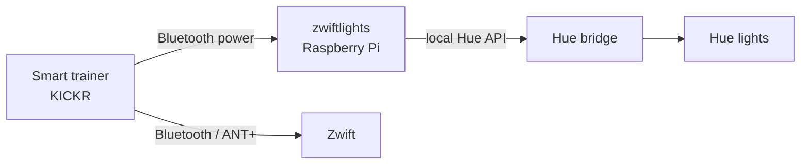

# zwiftlights

Philips Hue lights that follow your effort on the bike, using Zwift's power-zone colours. Ride easy and the room is soft white; push into threshold and it turns yellow; go all in and it glows red.

It reads power straight from your smart trainer over Bluetooth, so it doesn't need a Zwift API (there isn't a public one). It only *listens* to the trainer, so Zwift stays in full control of resistance, and it works the same with any other training app.



## Zones

Zone boundaries match Zwift's. With an FTP of 220 W:

| Zone | % FTP | Watts (FTP 220) | Light |
|---|---|---|---|
| Z1 Recovery | under 60% | under 132 W | soft white |
| Z2 Endurance | 60–75% | 132–166 W | blue |
| Z3 Tempo | 76–89% | 167–197 W | green |
| Z4 Threshold | 90–104% | 198–230 W | yellow |
| Z5 VO2max | 105–118% | 231–261 W | orange |
| Z6 Anaerobic | 119% and up | 262 W and up | red, full brightness |

Power is averaged over a few seconds, and there's a little hysteresis, so riding right on a zone boundary doesn't make the lights flicker. When you start pedalling it remembers how the lights were; after a while without pedalling it puts them back.

## What you need

- A smart trainer or power meter that broadcasts the standard Bluetooth **Cycling Power Service**. Most do. If Zwift also connects over Bluetooth, the trainer must allow more than one Bluetooth connection (Wahoo KICKRs from 2018 onwards do); otherwise run Zwift over ANT+.
- A Philips Hue bridge with colour lights, grouped in their own Hue room or zone (e.g. "Zwift Cave").
- Something to run it on: a Raspberry Pi with Bluetooth (a Pi 3 is plenty) is ideal, since it can sit in the corner and run all the time. A Mac or Linux machine works too.
- Python 3.11 or newer, and the [`bleak`](https://github.com/hbldh/bleak) Bluetooth library.

## Install on a Raspberry Pi

Flash Raspberry Pi OS Lite with [Raspberry Pi Imager](https://www.raspberrypi.com/software/) (set the hostname, Wi-Fi and SSH in its settings), then on the Pi:

```bash
git clone https://github.com/tomkealey/zwift-lights.git
cd zwift-lights
bash install.sh
```

`install.sh` installs the system packages, creates a Python virtual environment with `bleak`, and sets up a systemd service. Then:

```bash
venv/bin/python zwiftlights.py pair     # press the button on the Hue bridge when asked
venv/bin/python zwiftlights.py rooms    # check hue_room in config.toml matches your room
venv/bin/python zwiftlights.py test     # lights cycle through every zone colour
venv/bin/python zwiftlights.py scan     # pedal to wake the trainer; check it's listed

sudo systemctl enable --now zwiftlights # run in the background, start on boot
journalctl -u zwiftlights -f            # watch it live
```

From then on it just works: get on the bike and the lights follow you.

## Try it on a Mac

```bash
python3 -m venv venv && source venv/bin/activate
pip install bleak
python zwiftlights.py zones             # your watt ranges per zone
python zwiftlights.py simulate          # a fake one-minute ride, no hardware needed
python zwiftlights.py run --dry-run     # real trainer, zone changes printed, lights untouched
```

macOS asks whether Terminal may use Bluetooth the first time. If Zwift is running on the same Mac, macOS may hide the already-connected trainer from the scan; start zwiftlights first, or test without Zwift.

## Commands

| Command | What it does |
|---|---|
| `pair` | Pairs with the Hue bridge (saves `hue_key.json`) |
| `rooms` | Lists Hue rooms and zones and how many lights each has |
| `scan` | Lists nearby Bluetooth devices, marking power sources |
| `zones` | Prints the watt range of each zone for your FTP |
| `test` | Cycles the lights through every zone colour, then restores them |
| `simulate` | Fake ride through all the zones; add `--lights` to use the real lights |
| `run` | The main loop; add `--dry-run` to log zone changes without touching the lights |

## Settings

Everything lives in [`config.toml`](config.toml):

| Setting | Default | Meaning |
|---|---|---|
| `ftp` | `220` | Your FTP in watts; keep it in step with Zwift |
| `trainer_name` | `"KICKR 59E9"` | Bluetooth name of the trainer, or part of it |
| `hue_room` | `"Zwift Cave"` | Hue room or zone holding the lights |
| `bridge_ip` | `""` | Empty = find the bridge automatically |
| `smoothing_seconds` | `3` | Seconds of power averaged; higher is calmer but slower |
| `hysteresis_percent` | `2` | How far below a boundary (% of FTP) before dropping a zone |
| `min_zone_seconds` | `1.5` | How long a new zone must hold before the lights change |
| `idle_after_seconds` | `90` | No pedalling for this long ends the ride |
| `when_idle` | `"restore"` | After a ride: `restore` the lights, turn them `off`, or `leave` them |
| `fade_ms` | `400` | Colour fade time |

On the Pi, restart after editing: `sudo systemctl restart zwiftlights`.

Zone colours and brightness are in the `ZONES` table near the top of `zwiftlights.py`.

## Troubleshooting

- **Trainer not found:** pedal to wake it, run `scan`, and check `trainer_name`. If Zwift is connected over Bluetooth and the trainer only allows one connection, switch Zwift to ANT+.
- **Lights don't change:** run `rooms` and `test`. If the bridge can't be found, set `bridge_ip` (Hue app → Settings → Bridges → ⓘ).
- **Lights too jumpy:** raise `smoothing_seconds` to 5 or so.
- **Bluetooth missing after a cold start on a Pi 3** (`bluetoothctl show` says "No default controller available", `dmesg` shows `hci0: command 0x0c14 tx timeout`): the Pi 3's chip sometimes fails its startup, often after a voltage dip at power-on. `install.sh` adds a small `bt-recover` service that checks Bluetooth after every boot and resets the chip if needed; `journalctl -b -t bt-recover` shows whether it stepped in.
- **Under-voltage:** `vcgencmd get_throttled` should say `throttled=0x0`. Anything with a 5 in it (e.g. `0x50000`) means the supply dips; use a native micro-USB 5.1 V / 2.5 A supply on a Pi 3 rather than a USB-C supply with an adapter.

## Credits

Inspired by DC Rainmaker's write-up of [Philips Hue lights with Zwift](https://www.dcrainmaker.com/2026/01/philips-hue-lights-with-zwift.html), which covers LightMyWatts, a ready-made app that does the same job if you'd rather not tinker. Not affiliated with Zwift, Wahoo or Philips Hue.

## License

[MIT](LICENSE)
